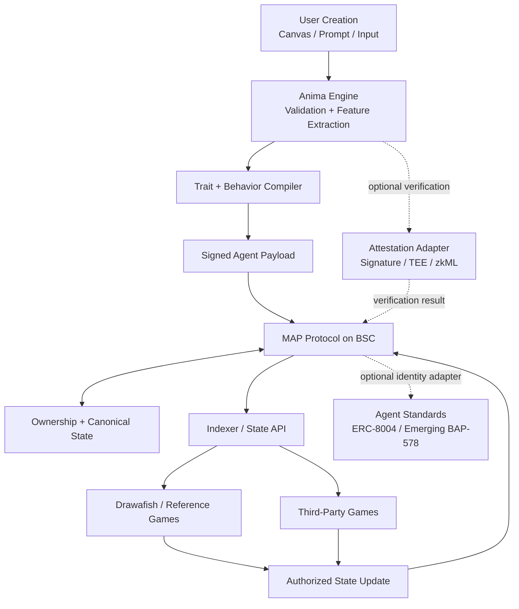

# 4. Architecture: MAP × Anima × Tank



## 4.1 MAP — Protocol Layer

**Definition:** An EVM-native protocol for persistent, portable game Agents.

MAP is implemented as a set of Solidity smart contracts and interfaces rather than a single monolithic NFT contract.

### Core Contract Modules

- **MAPAgentNFT:** ERC-721-compatible ownership and canonical Agent identifier.
- **MAPTraitRegistry:** Canonical trait namespaces and normalized values.
- **MAPStateRegistry:** Versioned state roots, progression summaries, verification status and critical checkpoints.
- **MAPGameAdapterRegistry:** Approved games, namespaces, read/write permissions, adapter metadata and revocation status.
- **MAPVerificationRegistry:** Signatures, attestations, proof references and verification states associated with creation or sensitive updates.

Token, treasury, vesting, marketplace and incentive contracts remain separate from the core Agent protocol to reduce upgrade risk and keep responsibilities clear.

## 4.2 State Design: Minimal On-Chain, Rich Off-Chain

Storing an Agent's entire lifetime history in contract storage would become expensive and difficult to scale. MAP therefore uses a hybrid state model.

### Stored on-chain

- owner and token ID;
- immutable DNA hash and visual/content hash;
- canonical traits required by games;
- current progression summary;
- behavior profile hash;
- verification state;
- authorization and nonces;
- content-addressed references where required.

### Emitted as events / indexed off-chain

- detailed evolution history;
- game interaction records;
- historical trait changes;
- non-critical telemetry;
- extended memory references;
- contribution attribution data.

This preserves public auditability without forcing every historical interaction into permanent contract storage.

## 4.3 Illustrative Solidity Data Model

```solidity
struct AgentCore {
    bytes32 dnaHash;
    bytes32 visualHash;
    bytes32 behaviorProfileHash;
    uint64 level;
    uint64 experience;
    uint32 generation;
    uint8 verificationStatus;
    uint64 stateNonce;
}

mapping(uint256 => AgentCore) public agentCore;
mapping(uint256 => mapping(bytes32 => int256)) internal traitValue;

event AgentStateUpdated(
    uint256 indexed tokenId,
    bytes32 indexed namespace,
    bytes32 stateHash,
    address indexed game,
    uint64 nonce
);
```

The production implementation may evolve after security review, gas profiling and integration testing. The whitepaper defines the intended interface model rather than freezing an unaudited implementation.

## 4.4 The MAP Socket Interface

Third-party games should not need to import MetaFishtank's full internal logic.

```solidity
function getTrait(uint256 tokenId, bytes32 traitKey)
    external view returns (int256);

function getAgentState(uint256 tokenId)
    external view returns (bytes32 stateHash, uint64 nonce);

function submitStateUpdate(StateUpdate calldata update, bytes calldata signature)
    external;
```

SDK wrappers can expose friendlier TypeScript, Unity and Unreal interfaces.

## 4.5 Controlled Write-Back

Cross-game evolution is powerful only if malicious games cannot arbitrarily modify Agents.

MAP therefore treats state mutation as a permissioned protocol action:

- games register an adapter and requested namespace;
- write scopes are limited by trait or state namespace;
- updates use nonces for replay protection;
- sensitive updates can require EIP-712 signatures from an authorized service or validator;
- rate limits and value bounds can be applied per adapter;
- emergency pause and revocation mechanisms protect compromised integrations;
- governance or multisig-controlled timelocks can be used for high-impact configuration changes.

This allows interoperability without turning the Agent into an unprotected shared database.

## 4.6 Canonical Traits vs. Game-Local State

MAP distinguishes between **canonical traits** and **namespaced game-local state**.

Examples:

- `speed` may be canonical;
- `deep_sea_racing.turbo_charge` may be game-specific;
- `aqua_arena.rank` may be another game's namespace.

A game adapter can propose bounded canonical changes when appropriate, while local mechanics remain isolated. This prevents one application's balance model from corrupting the entire ecosystem.
